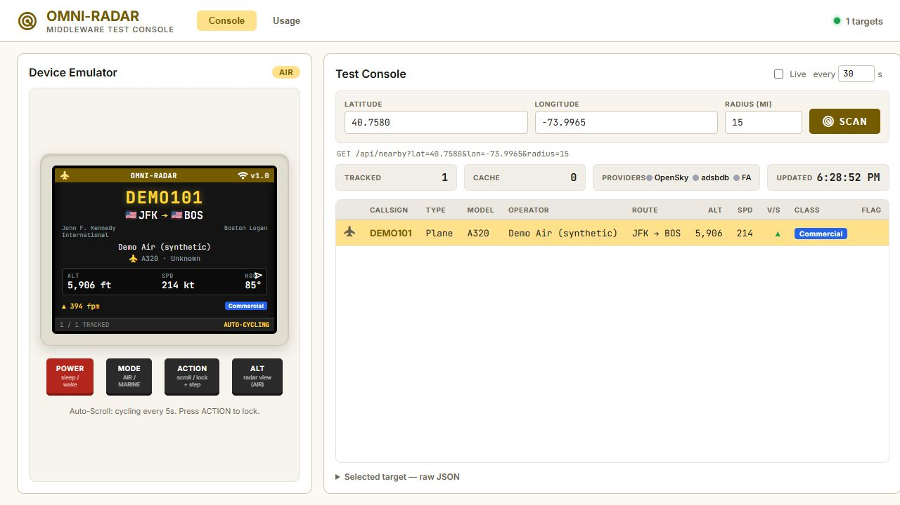
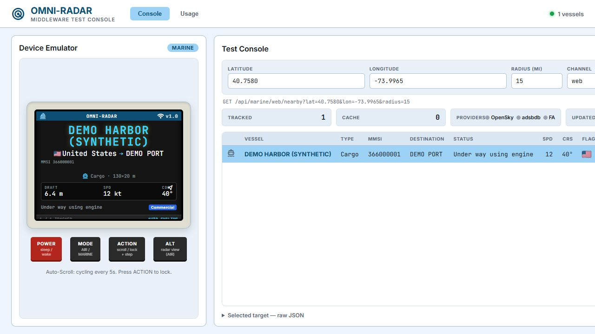

# Omni-Radar

**See nearby aircraft and vessels on a local web console or a dedicated ESP32 display.** Omni-Radar combines live traffic feeds with aircraft metadata, route lookups, and local classification so a callsign or AIS position becomes a readable target card.

It is a self-hosted project for aviation and marine enthusiasts, hardware hobbyists, and developers who want a small traffic display on their network. The middleware keeps provider credentials and enrichment work on a PC; the browser and device consume the same descriptive JSON API. You can use the web console without owning the display.

[Get started](#install-and-run) · [Features](#what-you-can-do) · [Engineering](#how-it-works) · [Checks](#verification) · [Limitations](#status-and-limitations) · [Detailed documentation](continuity/README.md)

## What you can do

| Capability | Concrete example |
| --- | --- |
| Find nearby aircraft | Request a 15-mile search around a coordinate and view callsign, aircraft type, altitude in feet, speed in knots, heading, and climb/descent rate. |
| Enrich aircraft records | Look up registration and model in a local aircraft CSV; resolve origin/destination through adsbdb, with optional FlightAware fallback. Missing metadata is shown as unknown. |
| Track marine traffic | Open an AIS channel such as `web` and view vessel name, MMSI, category, destination, navigation status, speed, dimensions, and draught when reported. |
| Inspect the data in a browser | Switch AIR/MARINE, scan a location, enable live refresh, select a table row, inspect raw JSON, and switch between a target card and radar view. ACTION locks or steps the selection. |
| Monitor provider usage | The Usage tab shows session counters, cache activity, external calls, and recommended polling intervals. |
| Use a physical display | ESP32 AIR firmware cycles through aircraft, supports target locking and radar view, and saves brightness, radius, polling, and cycle settings in NVS. Device MARINE mode is unfinished. |

### Console preview

These are real captures of the web console, taken in the Codex browser with a temporary local server supplying **synthetic records**. They demonstrate rendering, not live provider coverage or a physical device. The temporary preview is not a built-in application demo mode. See [capture notes](docs/images/README.md).



*AIR: a synthetic aircraft with route metadata, altitude, speed, heading, and vertical rate, alongside the LCD emulator.*



*MARINE: a synthetic cargo vessel in the browser emulator. The physical ESP32 firmware does not yet implement MARINE mode.*

## How it works

```text
OpenSky state vectors ──> AIR enrichment <── local aircraft CSV / lookup tables
                                ↑
                     adsbdb → FlightAware (optional)
                                ↓
                       persistent route cache

aisstream.io WebSocket ──> per-channel vessel store ──> MARINE enrichment

                    FastAPI JSON API
                     /           \
            web console       ESP32 display (AIR)
```

- **Python / FastAPI / Pydantic:** async HTTP endpoints, validated query parameters, typed payloads, and environment-based settings. Fields carry units, such as `altitude_feet` and `speed_knots`, to make the browser/firmware contract explicit.
- **httpx and provider throttles:** each AIR request makes one bulk OpenSky bounding-box poll. Route enrichment uses concurrent tasks with per-provider concurrency/interval limits. Successful routes are cached for 12 hours by default; definitive misses for 3 hours. Transient failures are not cached, so later polls can retry. The cache persists across restarts; live positions are fetched again.
- **websockets and an in-memory AIS store:** each marine channel opens its own subscription on demand. Position and static reports merge by MMSI. Vessels expire after 15 minutes of silence and channels after 8 hours without requests, by default. Marine enrichment needs no per-vessel HTTP lookup.
- **Plain JavaScript, HTML, and CSS:** the console uses ES modules and HTML partials with no frontend build step. A Python standard-library server proxies API calls to avoid a separate browser CORS setup. Selection, table rendering, device emulation, and usage reporting have separate modules.
- **Arduino C++ / PlatformIO / TFT_eSPI / ArduinoJson:** firmware targets an ESP32-3248S035 with a 480×320 ST7796 display and XPT2046 touch. It filters the JSON fields it parses to fit the embedded client. Browser and firmware layouts are maintained separately.

The API advertises `X-Recommended-Poll-Seconds`; the browser and firmware honor it to back off when OpenSky credits run low. This reduces repeated work but does not eliminate upstream limits or guarantee complete traffic coverage.

Source entry points: [API lifecycle and routes](app/main.py), [AIR pipeline](app/enrich.py), [marine channels](app/channels.py), [browser composition](web/js/main.js), and [firmware](hardware/src/main.cpp). See the [architecture](continuity/developer/architecture.md) and [payload model](continuity/data/model.md) for details.

## Install and run

### Prerequisites

- Python with `venv` and pip. Source uses Python 3.10+ syntax; **Python 3.14.3 is the version checked locally**, and the project declares no tested minimum version.
- Network access to install [Python dependencies](requirements.txt) and, for live AIR traffic, reach OpenSky. AIR can run anonymously; OpenSky OAuth client credentials enable authenticated access. adsbdb is keyless; FlightAware is optional. MARINE requires an aisstream.io API key.
- A browser for the console. Google Fonts and flagcdn.com supply its fonts/icons and flags.
- Optional: Node.js for JavaScript syntax checks; PlatformIO, the supported board, and a data-capable USB cable for firmware.

### 1. Create the Python environment

The Git repository is the `omni-radar/` directory inside the supplied project folder. Run the following from the repository root in PowerShell:

```powershell
cd C:\path\to\omni-radar
python -m venv .venv
.\.venv\Scripts\python.exe -m pip install -r requirements.txt
if (!(Test-Path .env)) { Copy-Item .env.example .env }
```

Using the environment's Python directly avoids requiring PowerShell activation. On macOS/Linux, use `.venv/bin/python` in place of `.\.venv\Scripts\python.exe` and copy `.env.example` to `.env` if it does not exist.

### 2. Configure `.env`

Edit the copied file. This example uses the repository's public example coordinates and blank credentials, not a private location or real keys:

```dotenv
HOST=127.0.0.1
PORT=8000
HOME_LAT=40.7580
HOME_LON=-73.9965
DEFAULT_RADIUS_MILES=15
OPENSKY_CLIENT_ID=
OPENSKY_CLIENT_SECRET=
FLIGHTAWARE_API_KEY=
AISSTREAM_API_KEY=
AISSTREAM_ENABLED=false
AIRCRAFT_DB_AUTO_DOWNLOAD=false
POLL_DEFAULT_SECONDS=30
```

Both OpenSky values must be present to authenticate. To enable live MARINE, add your aisstream key and set `AISSTREAM_ENABLED=true`. FlightAware is used only when its key is nonempty; consult provider terms and pricing before enabling it.

With aircraft DB auto-download disabled, the service uses a local CSV if present and otherwise runs with reduced model/registration enrichment. To download or refresh it explicitly:

```powershell
.\.venv\Scripts\python.exe scripts/download_aircraft_db.py
```

Alternatively, set `AIRCRAFT_DB_AUTO_DOWNLOAD=true`: startup downloads the large CSV when missing or older than 30 days by default. This is a metadata database, **not an offline source of live traffic**.

Settings load `.env` from the current working directory; environment variables override it. Run from the repository root. See [.env.example](.env.example), [settings source](app/config.py), and the [configuration guide](continuity/developer/setup.md#configuration) for cache paths, provider throttles, filters, and expiry settings. Keep credentials in ignored local files; do not commit `.env` or `hardware/include/config.h`.

### 3. Start the API and console

In the first terminal, from the repository root:

```powershell
.\.venv\Scripts\python.exe -m app.main
```

Check `http://127.0.0.1:8000/health` for `"status": "ok"`. Interactive API docs are at `http://127.0.0.1:8000/docs`. Health confirms service startup, not live provider availability.

In a second terminal, also from the repository root:

```powershell
.\.venv\Scripts\python.exe web/serve.py --port 8080 --api http://127.0.0.1:8000
```

Open `http://127.0.0.1:8080`. The console scans AIR on load. Enter a latitude, longitude, and radius; use SCAN for one request or Live for repeated refreshes. MODE switches to MARINE and exposes the channel field. New AIS channels may initially be empty while reports arrive.

Both processes stop with Ctrl+C. The API saves the route cache on shutdown. `serve.py` binds to all interfaces; the API defaults to all interfaces unless `HOST` is overridden. No application authentication is implemented. Use a trusted network. For the ESP32, set `HOST=0.0.0.0` and point its configuration at the middleware PC's LAN address.

### API examples

With the middleware running:

```powershell
Invoke-RestMethod 'http://127.0.0.1:8000/health'
Invoke-RestMethod 'http://127.0.0.1:8000/api/nearby?lat=40.7580&lon=-73.9965&radius=15'
Invoke-RestMethod 'http://127.0.0.1:8000/api/metrics'
# Requires enabled MARINE credentials; the first request opens a channel.
Invoke-RestMethod 'http://127.0.0.1:8000/api/marine/web/nearby?lat=40.7580&lon=-73.9965&radius=15'
```

An unavailable AIR upstream returns HTTP 502; disabled MARINE returns HTTP 503. A marine channel retains its original subscription box: after changing coordinates or radius, use a new channel key or explicitly repoint it with `POST /api/marine/{channel}?lat=...&lon=...&radius=...` (query parameters). Merely changing scan coordinates does not repoint the subscription. The [API reference](continuity/user/api.md) contains more detail; its older omissions are tracked in [status](continuity/status.md#documentation-drift), and the running `/docs` reflects the implemented schema.

### Optional ESP32 setup

Copy `hardware/include/config.example.h` to `hardware/include/config.h`; fill in WiFi credentials, the middleware LAN URL, and the search location. **Add `#define BRIGHTNESS 200`** to the local config: the example currently omits this required constant. Then, with PlatformIO installed:

```powershell
cd hardware
pio run
pio run --target upload
pio device monitor
```

The first build downloads the ESP32 platform/libraries. Serial monitoring uses 115200 baud. See the [hardware guide](continuity/developer/hardware.md) for pins, calibration, upload-port selection, and troubleshooting; its older TODO descriptions are qualified by [current status](continuity/status.md).

## Verification

There is **no automated test suite, CI workflow, lint configuration, or type-check configuration** in the repository. The available baseline checks, from the root in PowerShell, are:

```powershell
.\.venv\Scripts\python.exe -m pip check
.\.venv\Scripts\python.exe -m compileall -q app scripts web
.\.venv\Scripts\python.exe -c "import app.main"
Get-ChildItem web/js/*.js | ForEach-Object { node --check $_.FullName; if ($LASTEXITCODE -ne 0) { throw 'JavaScript syntax check failed' } }
```

The import check does not run the application lifespan or call providers. For runtime checks, start the service, check health, request nearby traffic, and inspect the console and Usage tab. Firmware compilation is `pio run` from `hardware/`; flashing and touch/display behavior require the board.

**Checked on 2026-10-14:** the commands above passed in the existing Python 3.14.3 environment, with a local pip warning about an invalid `~ip` distribution. Both script `--help` commands passed. An ad hoc isolated Python check exercised lifespan startup/shutdown, health, metrics, `/docs`, disabled-MARINE HTTP 503, invalid-radius HTTP 422, a synthetic AIR response with polling header, and AIS position/static merging plus vessel enrichment. The real browser console rendered synthetic AIR and MARINE records for the screenshots. Local static serving and the actual console proxy were also checked over HTTP. These checks used no provider credentials or live traffic.

**Not run:** fresh dependency installation, the external CSV download, live OpenSky/adsbdb/FlightAware/aisstream requests, firmware compilation, or flashing. Setup instructions for those steps are derived from source and configuration, not end-to-end verification. Detailed checks and their scope live in [setup](continuity/developer/setup.md#verify-a-change) and [status](continuity/status.md#last-verified-state).

## Status and limitations

The application reports version **1.0.0**. AIR is implemented across middleware, browser, and firmware; MARINE is implemented in middleware and browser. Device MARINE mode and a paid marine fallback provider remain unfinished/planned.

- The search uses an approximate **bounding box**, not an exact circular distance filter. Coverage, freshness, and route completeness depend on upstream data. AIR drops records without a usable callsign or position.
- Grounded/slow planes and moored/slow vessels are filtered by default, with exceptions for certain vehicle/service types. Unknown values and heuristic classifications are not authoritative identification.
- FlightAware-derived routes omit airport-country flags. Its model code currently takes precedence over the offline DB, contrary to an older guide.
- Marine subscription boxes require explicit repointing. Some marine usage gauges are delayed or shared across channels.
- The firmware config example needs the manual brightness addition above. Browser/firmware rendering parity is maintained by hand, and browser MARINE support does not imply device support.
- No packaged demo, automated regression suite, or deployment/authentication layer is supplied. Provider terms and data-redistribution permissions must be checked separately; the existing marine notes explicitly leave aisstream terms unverified.

See [known defects and documentation drift](continuity/status.md#known-defects), [AIR dependencies](continuity/developer/external-dependencies.md), and [marine dependency notes](continuity/developer/marine/external-dependencies.md). Some migrated guides preserve earlier design text; the status page records where source behavior differs.

## Explore the repository

| Path | Purpose |
| --- | --- |
| [app/](app/) | FastAPI service, provider clients, enrichment, stores, cache, and metrics |
| [web/](web/) | Browser console, LCD emulator, and static server/API proxy |
| [hardware/](hardware/) | ESP32 firmware, PlatformIO configuration, and asset generators |
| [scripts/](scripts/) | Aircraft database downloader |
| [continuity/](continuity/README.md) | Maintained documentation and deeper guides |

Start with [setup](continuity/developer/setup.md), [architecture](continuity/developer/architecture.md), [data model](continuity/data/model.md), [web console usage](continuity/user/web-console.md), or [current status](continuity/status.md). For implementation work, the [agent map](continuity/agent/map.md) routes features to their source and verification commands.
